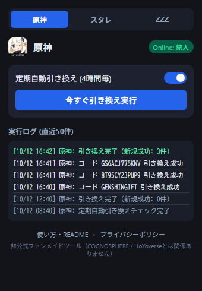

# HoYoPass - 交換コード自動引き換えツール

HoYoverseゲーム（**原神**、**崩壊：スターレイル**、**ゼンレスゾーンゼロ**）の最新交換コードを定期的に自動取得・一括引き換えするGoogle Chrome拡張機能（Manifest V3）です。

煩わしいコードのコピー＆ペースト作業から解放され、ゲーム内メールへ原石や星軌専用チケット、ポリクロームなどの報酬を自動で受け取ることができます。

<p align="center">
  
</p>

---

## 🌟 主な特徴

- **🎮 3大タイトルに完全対応**: 原神、崩壊：スターレイル、ゼンレスゾーンゼロをタブ1つで簡単切り替え。
- **⏱️ 完全自動バックグラウンド実行**: 拡張機能の画面を開いていなくても、ブラウザ動作中に3時間周期で3タイトル全て（原神、崩壊：スターレイル、ゼンレスゾーンゼロ）を自動巡回し、最新コードを引き換え。PC起動時やスリープ復帰時の自動キャッチアップ、通信エラー時の自動再試行機能も搭載。
- **🚀 ワンクリック即時引き換え**: 「今すぐ引き換え実行」ボタンで、現在画面で選択しているゲームに対してのみ、即座に新規コードの有無を確認・引き換え実行。
- **🔗 公式交換サイトへの直通ショートカット**: ゲームアイコンをクリックするだけで、公式の交換コード入力ページにジャンプ。
- **🛡️ ゼロトラスト・最高水準の安全性**:
  - パスワードや認証トークンの入力・保存は一切不要。
  - お使いのブラウザに保存された公式ログインCookieをローカルでのみ利用（Cookie文字列自体の読み取りや外部送信は行いません）。
  - 外部サーバーへの個人情報送信・トラッキングは一切ありません。

---

## 📥 インストール方法 (Chromeへの導入)

### 1. Chrome ウェブストアから追加 (推奨・一般利用者向け)

> [!NOTE]
> 現在、Chrome ウェブストアへの公開準備中です。公開完了後はストアページより「Chromeに追加」をクリックするだけで簡単にご利用いただけます。

1. **Chrome ウェブストア**の HoYoPass ページを開きます（*公開準備中*）。
2. 「**Chromeに追加**」ボタンをクリックします。
3. 確認ダイアログで「**拡張機能を追加**」を選択します。
4. **ツールバーへの固定表示 (推奨)**:
   - Chrome右上ツールバーのパズルピースアイコン（拡張機能メニュー）をクリックし、「HoYoPass」のピン留めアイコンをクリックして固定します。

---

### 2. ソースコードから導入 (開発者・テスター向け)

<details>
<summary><strong>デベロッパーモードでの手動インストール手順を展開する</strong></summary>

Chrome ウェブストアを経由せず、ソースコードから直接ビルド・動作確認を行いたい場合は、以下の手順で導入できます。

1. **リポジトリをダウンロード**:
   - 本リポジトリの「Code」ボタン → 「Download ZIP」をクリックして解凍するか、Gitでクローンします：
     ```bash
     git clone https://github.com/zyanpoyo/HoYoPass.git
     ```
2. **Chrome拡張機能管理ページを開く**:
   - Chromeのアドレスバーに `chrome://extensions/` と入力してEnterキーを押します。
3. **デベロッパーモードを有効化**:
   - 画面右上にある「**デベロッパー モード**」のスイッチをONにします。
4. **拡張機能を読み込む**:
   - 画面左上に表示される「**パッケージ化されていない拡張機能を読み込む**」をクリックします。
   - ダウンロード・解凍した `HoYoPass` フォルダ（`manifest.json` があるディレクトリ）を選択します。
5. **固定表示**:
   - ツールバーの拡張機能メニュー（パズルピースアイコン）からピン留めしてご利用ください。

</details>

---

## 📖 使い方ガイド

### Step 1: 初回起動と同意
- ツールバーのHoYoPassアイコンをクリックすると、初回のみ「利用開始のご確認」モーダルが表示されます。
- 免責事項およびプライバシーポリシーをご確認の上、「**同意して利用を開始する**」をクリックします。

### Step 2: 公式サイトでゲームアカウントにログイン
- ブラウザ上で、対象ゲームの公式サイトまたはHoYoLABに普段通りログインしておきます。
  - 原神: [公式コード交換サイト](https://genshin.hoyoverse.com/ja/gift)
  - 崩壊：スターレイル: [公式コード交換サイト](https://hsr.hoyoverse.com/gift)
  - ゼンレスゾーンゼロ: [公式コード交換サイト](https://zenless.hoyoverse.com/redemption/gift)
- ログイン完了後、HoYoPassのポップアップを開くと、画面上部のステータスバッジが `Online: [あなたのキャラクター名]` に変化します。

### Step 3: ゲームの切り替え
- 上部のタブ（「原神」「スタレ」「ZZZ」）をクリックすることで、対象ゲームを瞬時に切り替えられます。
- 各ゲームごとにログイン状況、キャラクター名、直近の実行ログが独立して管理されます。

### Step 4: 定期自動引き換え (全3タイトル一括・3時間毎)
- 「**定期自動引き換え (3時間毎)**」のトグルスイッチがONになっていれば、ブラウザ起動中にバックグラウンドで自動的に**全3タイトル（原神、崩壊：スターレイル、ゼンレスゾーンゼロ）を順次巡回**し、最新コードのチェックと引き換えを実行します。
- 未プレイのゲームは自動的に安全スキップされるため、一部のゲームのみプレイしている場合でも問題ありません。
- 新規コードの引き換えに成功した場合や、ログイン期限が切れた場合は、Chromeのデスクトップ通知でお知らせします。

### Step 5: 今すぐ引き換え実行 (選択中ゲームの手動実行)
- 新しい公式生放送などでコードが発表された直後など、今すぐ引き換えたいときは「**今すぐ引き換え実行**」ボタンを押します。
- **手動実行は、ポップアップ画面で現在選択しているゲームに対してのみ実行されます。** 他のゲームを引き換えたい場合はタブを切り替えてボタンを押すか、全タイトル自動巡回する定期自動引き換えをご利用ください。
- 処理が完了すると、選択中のゲームに応じた結果ダイアログ（成功件数やスキップ・エラー理由）が表示されます。

### Step 6: 公式交換サイトへのジャンプ
- タイトル左側のゲームアイコンをクリックすると、現在選択しているゲームの公式交換コード入力ページが新しいタブで開きます。

---

## ❓ よくある質問 (FAQ)

<details>
<summary><strong>Q. PCをスリープさせたり、毎日シャットダウンしていてもバックグラウンド実行されますか？</strong></summary>

はい、確実に取りこぼさない仕組みを備えています。
- **スリープ運用の場合**: PCスリープ中はOSタイマーが停止しますが、PCのスリープを解除して操作を再開したタイミング（`idle` 復帰）で、前回から3時間以上経過していれば自動的にキャッチアップ実行されます。復帰直後にWi-Fi未接続でエラーになった場合も、2分後に自動再試行されます。
- **毎日シャットダウン運用の場合**: Chromeを起動した際（`onStartup`）、前回から3時間以上経過していれば15秒後に自動的にキャッチアップ実行されます。PCを開いて短時間しか作業しない場合でも取りこぼしません。
※なお、Chromeが完全に終了している状態やPCの電源が落ちている間は拡張機能は動作しません。
</details>

<details>
<summary><strong>Q. 手動で引き換え実行した際、他のゲームも同時に引き換えられますか？</strong></summary>

いいえ、ポップアップ画面の「今すぐ引き換え実行」ボタンは、**現在選択しているタブのゲームに対してのみ**即時引き換えを行います。別のゲームも手動で引き換えたい場合は、上部のタブを切り替えてからボタンを押してください。なお、バックグラウンドでの定期自動引き換え（3時間毎）は、3タイトル全てを自動で巡回して引き換えます。
</details>

<details>
<summary><strong>Q. ステータスに「未ログイン」と表示されます</strong></summary>

ブラウザ上でHoYoverseアカウントのログインセッションが切れている可能性があります。アイコンをクリックして公式交換サイトを開き、再度ログインを行ってからポップアップを開き直してください。
</details>

<details>
<summary><strong>Q. 「キャラクター不在」と表示されます</strong></summary>

ログインしているHoYoverseアカウントに対象ゲームのキャラクター（UID）が作成されていないか、サーバー地域が初期状態の場合があります。ゲーム内でキャラクター作成・チュートリアル完了を行っているかご確認ください。
</details>

<details>
<summary><strong>Q. 「バックオフ中（一時待機）」と表示されるのはなぜですか？</strong></summary>

短時間に多数のリクエストが送信された場合や、公式APIから混雑エラーが返ってきた場合に、アカウント安全保護のため自動的に30分間のクールダウンに入ります。30分経過すると自動的に通常状態に復帰します。
</details>

<details>
<summary><strong>Q. 垢BAN（アカウント停止）のリスクはありますか？</strong></summary>

本拡張機能は、公式交換サイトで人間が手動入力するのと同一の公式APIを使用し、かつリクエスト間隔に5.2秒以上のウェイトを設けて公式サーバーに過度な負荷をかけないよう厳格に制御されています。また、パスワードや機密トークンの保存・不正通信も行いません。ただし、非公式ツールである点をご留意の上ご利用ください。
</details>

---

## 🔒 プライバシー & セキュリティ

HoYoPassは利用者のプライバシーを尊重し、Cookieや認証情報の漏洩リスクを根本から排除する設計となっています。
- 外部サーバーへの個人情報・ログの送信は一切行いません。
- 詳細なプライバシーポリシーは [プライバシーポリシー (docs/legal/privacy_policy.md)](docs/legal/privacy_policy.md) をご覧ください。

---

## 🛠️ 開発者向け情報 & システム構成

本拡張機能のアーキテクチャ、ゼロトラスト認証の実装詳細、外部API仕様、排他制御アルゴリズムなど、技術的な詳細仕様については以下をご確認ください：

👉 **[システムアーキテクチャ & 技術仕様書 (docs/design/architecture.md)](docs/design/architecture.md)**

### 開発・テスト手順
```bash
# 依存関係セットアップ（アイコン生成等）
npm run setup

# 単体テストの実行（Node.js組み込みテスト）
npm test

# 機密情報混入スキャン
npm run check-secrets

# ストア掲載用スクリーンショットの自動生成
npm run generate-screenshots
```

### ストア公開用パッケージ (ZIP) の作成
Chrome Web Store 申請用の配布パッケージ（不要な開発ファイル・テスト・ドキュメントを完全除外したクリーンなZIP）は、以下のコマンドで一括生成できます：

```bash
npm run package
```

- **出力先**: `dist/hoyopass-v1.0.1.zip`
- **処理内容**:
  1. プリフライト検証（`npm test` および `npm run check-secrets` の自動実行）
  2. 本番実行に不要なファイル（`spike/`, `test/`, `scripts/`, `docs/`, `CHROMEWEBSTORE.md` 等）の除外
  3. 必要なアセット（`manifest.json`, `src/`, `icons/`, `assets/`, `LICENSE`, `NOTICE`）のみをホワイトリスト抽出してZIPアーカイブ化

---

## 📄 免責事項・ライセンス

- **免責事項**: 本拡張機能は非公式のファンメイドツールであり、COGNOSPHERE / miHoYo / HoYoverseとは一切関係ありません。本ツール内で使用されているゲーム画像・商標の権利は、各権利者に帰属します。
- **ライセンス**: 本プロジェクトは [MIT License](LICENSE) の下で公開されています。
- **サードパーティクレジット & 法的適合性**: 使用しているリソースやライセンス表記の詳細は [NOTICE](NOTICE)、および [ライセンス適合性調査レポート (docs/legal/license_compliance_report.md)](docs/legal/license_compliance_report.md) をご覧ください。
