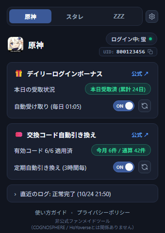

# HoYoPass - ログボ＆交換コード自動受取 for 原神/スタレ/ZZZ

HoYoverseゲーム（**原神**、**崩壊：スターレイル**、**ゼンレスゾーンゼロ**）の**デイリーログインボーナス**および**最新交換コード（シリアルコード）**をバックグラウンドで完全自動受け取りするGoogle Chrome拡張機能（Manifest V3）です。

毎日のHoYoLABログインボーナスの受け取り忘れや、煩わしい交換コードのコピー＆ペースト作業から完全に解放され、原石や星玉、ポリクロームなどの報酬を取りこぼすことなくゲーム内メールで受け取ることができます。

<p align="center">
  
</p>

---

## 🌟 主な特徴

- **🌐 多言語対応（日本語 / 英語）＆ロケーション自動適応**:
  - ブラウザの表示言語に合わせて日本語・英語を自動判定。設定（⚙）から `自動` / `日本語` / `English` の手動切り替えも可能。
  - お使いのPCのタイムゾーンに合わせて現地時刻で自動実行時刻（例: JSTなら `01:05`、PDTなら `09:05`）を自動換算表示。
  - 公式API（コード交換・ログインボーナス）への言語パラメータ（`lang`）および公式サイトURLも設定言語に合わせて自動で最適化。
- **🎁 デイリーログインボーナス自動受け取り (毎日 00:05 UTC+8 / 01:05 JST)**:
  - HoYoLABの日付切り替え（毎日 00:00 UTC+8 / 日本時間 午前1:00）直後に独立したデイリーアラームが発火し、全3タイトルのログインボーナスを自動巡回して受け取ります。
  - ポップアップ上で「本日の受取状況（受取済 / 未受取）」と「今月の累計ログイン日数」をリアルタイムに確認でき、「今すぐボーナス受取」ボタンで手動受取も可能です。
- **🎟️ 交換コード定期自動引き換え (3時間毎)**:
  - 拡張機能の画面を開いていなくても、3時間周期で全3タイトルを自動巡回し、最新の有効コードを一括引き換えします。
  - 生放送直後などは「今すぐ引き換え実行」ボタンで選択中のゲームを即座に引き換え可能です。
- **💻 スリープ復帰・PC起動時の自動キャッチアップ**:
  - 夜間PCをシャットダウンやスリープにしていても、翌朝PCやChromeを起動したタイミングで「本日未受取のログインボーナス」と「未チェックの交換コード」を自動で直列キャッチアップ実行します。
- **📊 コード適用実績 & 有効コード消化率の可視化**:
  - ポップアップ上で「有効コードの消化状況（例: `有効コード 6/6 適用済`）」と「今月・通算のコード適用件数（例: `今月 6件 / 通算 42件`）」を完全自動・ノーメンテナンスで一目で確認できます。
- **🎛️ 機能別の独立ON/OFF制御 & スマートUI**:
  - 「ログインボーナス自動受け取り」と「交換コード自動引き換え」の自動実行トグルを個別にON/OFF可能。
  - ヘッダーのゲームUIDワンクリックコピー機能や、選択中タイトルの直近実行状況を1行で確認・展開できるアコーディオン式ログを搭載。
- **🛡️ ゼロトラスト・最高水準の安全性 & 容易なオプトアウト**:
  - パスワードや認証トークンの入力・保存、`cookies` 権限の要求は一切不要。
  - お使いのブラウザに保存された公式ログインCookie（`.hoyolab.com` および `.hoyoverse.com` のデュアルドメイン対応）をローカル透過通信（`credentials: 'include'`）でのみ利用し、外部サーバーへのCookie・アカウント情報送信は一切行いません。
  - 障害検知および引き換え成功率の把握のため Google Analytics 4 Measurement Protocol による匿名の利用統計収集を行っています（UIDやアカウント情報は一切収集されません）。設定（⚙）からいつでもワンクリックで無効化（オプトアウト）が可能です。

---

## 📥 インストール方法 (Chromeへの導入)

### 1. Chrome ウェブストアから追加 (推奨・一般利用者向け)

> [!NOTE]
> 現在、Chrome ウェブストアへの公開準備中です。公開完了後はストアページより「Chromeに追加」をクリックするだけで簡単にご利用いただけます。

1. **Chrome ウェブストア**の HoYoPass ページを開きます（*公開準備中*）。
2. 「**Chromeに追加**」ボタンをクリックします。
3. 確認ダイアログで「**拡張機能を追加**」を選択します。
4. **ツールバーへの固定表示 (推奨)**:
   - Chrome右上ツールバーのパズルピースアイコン（拡張機能メニュー）をクリックし、「HoYoPass」のピン留めアイコンをクリックして固定します。

---

### 2. ソースコードから導入 (開発者・テスター向け)

<details>
<summary><strong>デベロッパーモードでの手動インストール手順を展開する</strong></summary>

Chrome ウェブストアを経由せず、ソースコードから直接ビルド・動作確認を行いたい場合は、以下の手順で導入できます。

1. **リポジトリをダウンロード**:
   - ソースコードZIPを解凍するか、Gitでクローンします（※現在GitHubリポジトリ一時停止中のため、配布パッケージをご利用ください）：
     ```bash
     git clone https://github.com/zyanpoyo/HoYoPass.git
     ```
2. **Chrome拡張機能管理ページを開く**:
   - Chromeのアドレスバーに `chrome://extensions/` と入力してEnterキーを押します。
3. **デベロッパーモードを有効化**:
   - 画面右上にある「**デベロッパー モード**」のスイッチをONにします。
4. **拡張機能を読み込む**:
   - 画面左上に表示される「**パッケージ化されていない拡張機能を読み込む**」をクリックします。
   - ダウンロード・解凍した `HoYoPass` フォルダ（またはビルド後の `dist/prod` / `dist/dev` フォルダ）を選択します。
5. **固定表示**:
   - ツールバーの拡張機能メニュー（パズルピースアイコン）からピン留めしてご利用ください。

</details>

---

## 📖 使い方ガイド

> 🌐 **公式Webサイト（使い方ガイド）**: [https://hoyopass.pages.dev/](https://hoyopass.pages.dev/)

### Step 1: 初回起動と同意
- ツールバーのHoYoPassアイコンをクリックすると、初回のみ「利用開始のご確認」モーダルが表示されます。
- 免責事項およびプライバシーポリシーをご確認の上、「**同意して利用を開始する**」をクリックします（自動でログボ受取・コード引き換えの両方が有効になります）。

### Step 2: 公式サイトまたはHoYoLABでログイン
- ブラウザ上で、HoYoLABまたは各ゲームの公式交換サイトに普段通りログインしておきます（デュアルドメイン対応のため、どちらでログインしていても動作します）。
  - **原神**: [公式ログボページ](https://act.hoyolab.com/ys/event/signin-sea-v3/index.html?act_id=e202102251931481) / [公式コード交換サイト](https://genshin.hoyoverse.com/ja/gift)
  - **崩壊：スターレイル**: [公式ログボページ](https://act.hoyolab.com/bbs/event/signin/hkrpg/index.html?act_id=e202303301540311) / [公式コード交換サイト](https://hsr.hoyoverse.com/gift)
  - **ゼンレスゾーンゼロ**: [公式ログボページ](https://act.hoyolab.com/bbs/event/signin/zzz/index.html?act_id=e202406031448091) / [公式コード交換サイト](https://zenless.hoyoverse.com/redemption/gift)
- ログイン完了後、HoYoPassのポップアップを開くと、画面上部のステータスバッジが `ログイン中: [あなたのキャラクター名]` に変化し、ゲームUID（クリックでコピー可能）が表示されます。

### Step 3: ゲームの切り替え
- 上部のタブ（「原神」「スタレ」「ZZZ」）をクリックすることで、対象ゲームを瞬時に切り替えられます。
- 各ゲームごとにログイン状況、本日のログインボーナス受取状況・累計日数、交換コードの適用実績・手動実行が行えます。

### Step 4: 🎁 デイリーログインボーナスの自動・手動受取
- **自動受け取り**: 「**自動受け取り (毎日 01:05)**」のトグルスイッチがONになっていれば、毎日午前1:05（またはその日の初回PC起動・スリープ復帰時）に全3タイトルのログインボーナスを自動巡回して受け取ります。
- **手動受け取り**: トグルスイッチ右隣の更新ボタン（**↻ 今すぐボーナス受取**）を押すと、現在選択中のゲームのログインボーナスを即座に受け取ります。
- **公式ページへ移動**: カード右上の「**公式 ↗**」ボタンを押すと、選択中ゲームの公式HoYoLABログインボーナスページが開きます。

### Step 5: 🎟️ 交換コードの自動・手動引き換え
- **定期自動引き換え**: 「**定期自動引き換え (3時間毎)**」のトグルスイッチがONになっていれば、3時間周期で全3タイトルの最新コードを自動検知・引き換えします。
- **手動引き換え**: 生放送直後などにトグルスイッチ右隣の更新ボタン（**↻ 今すぐ引き換え実行**）を押すと、現在選択中のゲームに対して即座に新規コードの引き換えを実行します。
- **コード適用実績と消化率の確認**:
  - **左側（消化状況）**: 現在受け取り可能な有効コードのうち、あなたのアカウントへ適用済みの件数（例: `有効コード 6/6 適用済`）を表示します。全件回収時は右側のピルが緑色となり、取りこぼしがゼロであることを一目で確認できます。
    - ※ 外部のコード一覧サイトに残っていても、公式サーバー側ですでに期限切れと判明した過去のコードは母数（分母）から自動除外されます。
  - **右側（適用実績ピル）**: 「**今月 ◯件 / 通算 ◯件**」として、当月および導入以来の適用コード累計数を表示します。
  - **次回実行予定の確認**: 右側の実績ピルにマウスカーソルを合わせると、ツールチップで次回の自動実行予定時刻（例: `次回自動実行予定: 18:00`）を確認できます。
- **公式交換サイトへ移動**: カード右上の「**公式 ↗**」ボタンまたはヘッダーのゲームアイコンをクリックすると、公式の交換コード入力ページが開きます。

> [!NOTE]
> **初回利用時のゲーム内メールについて**:
> 本拡張機能の初回実行時は、現在公開されている有効な交換コード一覧をすべて巡回して引き換えを試みます。事前にゲーム内などで手動交換済みのコードがある場合、ゲーム内に「交換コードは既に使用されています（報酬なし）」という重複通知メールが数件届く場合がありますが、これは公式APIの仕様による正常な挙動です。アカウントへの実害はなく、一度処理されたコードは拡張機能内に「交換済み」として記録されるため、次回以降に同じメールが再送されることはありません。

---

## ❓ よくある質問 (FAQ)

<details>
<summary><strong>Q. ログインボーナスは何時に更新・自動受け取りされますか？</strong></summary>

HoYoLABのデイリーログインボーナスは毎日 **00:00 (UTC+8) ＝ 日本時間の午前1:00** に日付が切り替わります。
HoYoPassは毎日 **午前1:05** にデイリー専用アラームで自動受け取りを実行します。夜間にPCの電源を切っている場合でも、翌朝PCを起動してChromeを開いたタイミング（またはスリープ復帰時）に「本日未受取」であることを自動検知して即座に受け取ります。
</details>

<details>
<summary><strong>Q. PCをスリープさせたり、毎日シャットダウンしていてもバックグラウンド実行されますか？</strong></summary>

はい、確実に取りこぼさない仕組みを備えています。
- **スリープ運用の場合**: PCのスリープを解除して操作を再開したタイミング（`idle` 復帰）で、本日未受取のログインボーナスおよび前回から3時間以上経過したコード引き換えが直列で自動キャッチアップ実行されます。
- **毎日シャットダウン運用の場合**: Chromeを起動した際（`onStartup`）、15秒後に自動的にログインボーナスと交換コードのキャッチアップ判定が実行されます。
※なお、Chromeが完全に終了している状態やPCの電源が落ちている間は拡張機能は動作しません。
</details>

<details>
<summary><strong>Q. 「セキュリティ認証(CAPTCHA)が必要」と通知されました</strong></summary>

HoYoLAB側のセキュリティ保護（Geetestパズル認証）が一時的に発動した場合、自動リクエストだけでは突破できないため、通知またはダイアログでお知らせします。通知をクリックするか、ログインボーナスカード右上の「公式 ↗」ボタンから公式ページを開いて1度手動でチェックインしてください。
</details>

<details>
<summary><strong>Q. 手動でボタンを押した際、他のゲームも同時に処理されますか？</strong></summary>

いいえ、ポップアップ画面の各カードにある更新ボタン（↻ 今すぐボーナス受取 / 今すぐ引き換え実行）は、**現在選択しているタブのゲームに対してのみ**即時実行を行います。なお、バックグラウンドでの自動実行（毎日 01:05 のログボ受取 / 3時間毎のコード引き換え）は、3タイトル全てを自動で巡回します（未プレイのタイトルは安全にスキップされます）。
</details>

<details>
<summary><strong>Q. 交換コードの実績件数（今月 / 通算）や消化率はどのようにカウントされますか？</strong></summary>

本拡張機能では、アイテム名などの外部データに依存せず、正確・安全にカウントを行っています。

- **有効コード消化率（例: `有効コード 6/6 適用済`）**:
  現在公開されている有効コード総数のうち、あなたのアカウントで適用が完了している件数です。全件回収済みの場合は緑色のピルが表示され、「取りこぼしゼロ」をひと目で確認できます。
  - ※ 外部のコード一覧サイトに残っていても、公式サーバー側ですでに「期限切れ」と判定された過去のコードは母数（分母）から自動除外されるため、今現在受け取り可能なコードに対する正確な消化率が表示されます（自分がすでに交換成功したコードが後日期限切れになっても、適用済の記録は保護されるため消えることはありません）。
- **今月の実績件数（`今月 ◯件`）**:
  HoYoLABの日付基準（UTC+8 / 日本時間 毎月1日 午前1:00）以降に適用されたコードの件数です。月が変わると自動的に0件から再カウントされます。
- **通算実績件数（`通算 ◯件`）**:
  本拡張機能を導入して以降、あなたのアカウントに適用されたコードの累計件数です。
- **手動交換済みコードの扱い**:
  「HoYoPassによる自動引き換え成功」に加え、「事前にゲーム内や公式サイトで手動交換済みであることが確認されたコード」も適用済みとして正しくカウントされます。そのため、生放送直後に自分で手動入力した場合でも「未回収」と判定されたり、数字の食い違いが起きることはありません。
</details>

---

<details>
<summary><strong>Q. 垢BAN（アカウント停止）のリスクはありますか？</strong></summary>

本拡張機能は、公式Webサイトで人間が操作するのと同一の公式APIを使用し、かつ適切なリクエスト間隔とバックオフ制御を設けて公式サーバーに過度な負荷をかけないよう厳格に設計されています。また、パスワードや機密トークンの保存・不正通信も行いません。ただし、非公式ツールである点をご留意の上ご利用ください。
</details>

---

<details>
<summary><strong>Q. 初回利用時、ゲーム内に「交換コードはすでに使用済みです」というメールが届くのはなぜですか？</strong></summary>

本拡張機能の初回実行時は、現在公開されている有効な交換コード一覧を取得して自動引き換えを行います。
事前にゲーム内等で手動交換済みのコードが存在する場合、公式APIの仕様（二段階判定）によりWeb上では受付完了となり、ゲーム内メールにて「使用済み（重複）」の通知が届くことがあります。
これはゲーム側の重複受取防止システムによる正常な挙動であり、アカウントへのペナルティ等の実害は一切ありません。一度処理されたコードは拡張機能内に「交換済み」として記録されるため、次回以降に同じメールが再送されることはありませんのでご安心ください。
</details>

---

## 🔒 プライバシー & セキュリティ

HoYoPassは利用者のプライバシーを尊重し、Cookieや認証情報の漏洩リスクを根本から排除する設計となっています。
- アカウント情報、ログインCookie、パスワード等の個人情報を外部サーバーへ送信することは一切ありません（品質改善用の匿名利用統計は設定からいつでもオプトアウト可能です）。
- 詳細なプライバシーポリシーは [プライバシーポリシー (Web版)](https://hoyopass.pages.dev/privacy) または [docs/legal/privacy_policy.md](docs/legal/privacy_policy.md) をご覧ください。

---

## 🛠️ 開発者向け情報 & システム構成

本拡張機能のアーキテクチャ、2系統アラーム設計、ゼロトラスト認証の実装詳細、外部API仕様については以下をご確認ください：

👉 **[システムアーキテクチャ & 技術仕様書 (docs/design/architecture.md)](docs/design/architecture.md)**

### プロダクトフレーバー (dev / prod) のビルド & 開発
同一コードベースから、開発・検証用（短縮周期・DEV表示）と製品用（本番周期）をコマンド1つで独立ビルドできます：

```bash
# 開発用フレーバーのビルド（コード定期実行: 3時間毎、名称: HoYoPass [DEV]）
npm run build:dev

# ソースコード変更の自動監視・再ビルド（開発時推奨）
npm run watch:dev

# 製品用フレーバーのビルド（コード定期実行: 3時間毎、本番名称）
npm run build:prod
```

### 開発・テスト手順
```bash
# 依存関係セットアップ（アイコン生成等）
npm run setup

# 単体テストの実行（Node.js組み込みテスト）
npm test

# 機密情報混入スキャン
npm run check-secrets

# ストア掲載用スクリーンショットの自動生成
npm run generate-screenshots
```

### ストア公開用パッケージ (ZIP) の作成
Chrome Web Store 申請用の配布パッケージは以下のコマンドで一括生成できます：

```bash
npm run package
```

- **出力先**: `dist/hoyopass-v1.3.1.zip`

---

## 📄 免責事項・ライセンス

- **免責事項**: 本拡張機能は非公式のファンメイドツールであり、COGNOSPHERE / miHoYo / HoYoverseとは一切関係ありません。本ツール内で使用されているゲーム画像・商標の権利は、各権利者に帰属します。
- **ライセンス**: 本プロジェクトは [MIT License](LICENSE) の下で公開されています。
- **サードパーティクレジット & 法的適合性**: 使用しているリソースやライセンス表記の詳細は [NOTICE](NOTICE)、および [ライセンス適合性調査レポート (docs/legal/license_compliance_report.md)](docs/legal/license_compliance_report.md) をご覧ください。
