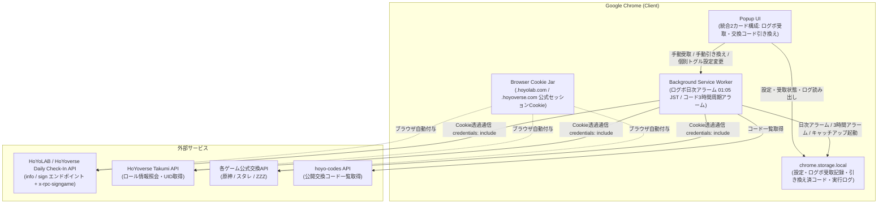

# HoYoPass システムアーキテクチャ & 技術仕様書

本書は、Chrome拡張機能「HoYoPass - ログボ＆交換コード自動受取ツール」の内部設計、システム構成、セキュリティモデル、およびアルゴリズム仕様をまとめた技術仕様書です。

---

## 1. システム概要 & 全体構成図

HoYoPassは、Google Chromeの拡張機能仕様（Manifest V3）に準拠したクライアント完結型の拡張機能です。専用のバックエンドサーバーを持たず、ブラウザのバックグラウンドService Workerと公式API（HoYoLAB / HoYoverse）、およびオープンソースの交換コードAPIのみと直接通信します。



---

## 2. ゼロトラスト認証 & セキュリティモデル

本拡張機能の最大の設計指針は、**「ユーザーの認証情報を拡張機能自身が触らない・保持しない」** ゼロトラストセキュリティです。

### 2.1 Cookieの非保持とブラウザ委任 (`credentials: 'include'`)
- 通常のスクレイピングや非公式ボットでは、ユーザーにログインCookieの手動貼り付けや入力を求めるケースが多く存在します。これにはCookieの流出や不正利用のリスクが伴います。
- HoYoPassでは、`fetch()` リクエスト時に `credentials: 'include'` を指定することで、ブラウザがすでに保持している公式Cookieをリクエストヘッダーへ自動付加させます。
- 拡張機能のJavaScriptコード内にはCookie情報（`account_mid_v2` や `ltuid_v2`、`ltoken_v2` 等）を一切読み込まず、メモリやストレージにも一切保存しません。

### 2.2 デュアルドメインCookieモデル（`.hoyolab.com` & `.hoyoverse.com`）
- HoYoLABの公式ログインボーナスページ（`act.hoyolab.com`）は `.hoyolab.com` ドメインにセッションCookieを保存し、各ゲームの公式ギフト交換ページ（`*.hoyoverse.com`）は `.hoyoverse.com` ドメインにセッションCookieを保存します。
- HoYoPassは、ログインボーナスAPIおよびTakumiロール照会APIの呼び出しにおいて、`*.hoyolab.com` をプライマリ、`*.hoyoverse.com` をセカンダリ（未ログインエラー `-100` / `-1071` 発生時の自動フォールバック）として順次試行するデュアルホスト設計を採用しています。

### 2.3 最小権限原則（`cookies` 権限の完全排除）
- `manifest.json` において、`cookies` API 権限を明示的に要求していません。
- これにより、悪意あるコードインジェクションや拡張機能の改ざんが発生した場合でも、ユーザーのCookieを盗み出す権限自体が存在しません。

### 2.4 ホスト権限（`host_permissions`）の厳格限定
通信可能なオリジンを以下の公式ドメインおよび検証済みコード配布APIのみに制限しています：
- `https://api-os-takumi.hoyoverse.com/*` / `https://api-os-takumi.hoyolab.com/*`（公式ユーザーロール照会API）
- `https://sg-hk4e-api.hoyolab.com/*` / `https://sg-hk4e-api.hoyoverse.com/*`（原神 ログボ受取・交換コード引き換えAPI）
- `https://sg-public-api.hoyolab.com/*` / `https://sg-public-api.hoyoverse.com/*`（崩壊：スターレイル ログボ受取API）
- `https://sg-hkrpg-api.hoyoverse.com/*`（崩壊：スターレイル 交換コード引き換えAPI）
- `https://sg-act-nap-api.hoyolab.com/*` / `https://sg-act-nap-api.hoyoverse.com/*` / `https://public-operation-nap.hoyoverse.com/*`（ゼンレスゾーンゼロ ログボ受取・交換コード引き換えAPI）
- `https://hoyo-codes.seria.moe/*`（検証済み公開交換コード取得API: [seriaati/hoyo-codes](https://github.com/seriaati/hoyo-codes)）

### 2.5 Content Security Policy (CSP)
Manifest V3の厳格なCSPを採用し、インラインスクリプトや外部スクリプトのロード（`eval` や外部CDN経由のJSなど）を全面的に遮断しています。

---

## 3. 外部API仕様 & 連携先GitHubリポジトリ

HoYoPassが利用・通信する外部APIの詳細および仕様・ソースコードのリファレンスとなるGitHubリポジトリは以下の通りです。

### 3.1 HoYoLAB / HoYoverse デイリーログインボーナスAPI（Daily Check-In API）
HoYoLABの公式デイリーチェックインページ（`act.hoyolab.com`）が内部通信で使用している公式REST APIです。

- **各タイトルのエンドポイント & 設定値**:
  | ゲーム | `act_id` | `x-rpc-signgame` ヘッダ | `info` パス | `sign` パス | 対応ホスト（Primary / Secondary） |
  | :--- | :--- | :--- | :--- | :--- | :--- |
  | **原神** | `e202102251931481` | `hk4e` | `/event/sol/info` | `/event/sol/sign` | `sg-hk4e-api.hoyolab.com` / `sg-hk4e-api.hoyoverse.com` |
  | **崩壊：スターレイル** | `e202303301540311` | `hkrpg` | `/event/luna/hkrpg/os/info` | `/event/luna/hkrpg/os/sign` | `sg-public-api.hoyolab.com` / `sg-public-api.hoyoverse.com` |
  | **ゼンレスゾーンゼロ** | `e202406031448091` | `zzz` | `/event/luna/zzz/os/info` | `/event/luna/zzz/os/sign` | `sg-act-nap-api.hoyolab.com` / `sg-act-nap-api.hoyoverse.com` |
- **必須カスタムヘッダー**:
  - `x-rpc-signgame`: 特にゼンレスゾーンゼロ（`/event/luna/zzz/os/sign`）では、`x-rpc-signgame: zzz` ヘッダーがない場合、未ログイン時であっても `{"retcode":-100,"message":"请从游戏内打开参与活动"}` で拒否されるため、全タイトルで必須ヘッダーとして付与しています。
- **CAPTCHA（リスク検証）検知**:
  - `sign` エンドポイントは HTTP 200 かつ `retcode: 0` であっても、`data.is_risk === true` または `data.gt_result?.is_risk === true`（あるいは `retcode === 1034`）としてGeetest CAPTCHA検証を要求する場合があります。
  - `isCaptchaRisk()` によりこれを検知した際は「受取済」として誤記録せず、ユーザーへ公式チェックインページでの手動認証を促す通知を発行します。
- **実装箇所**: [`src/services/hoyo-api.js`](../../src/services/hoyo-api.js) (`getDailySignInfo`, `claimDailyBonus`, `isCaptchaRisk`)

### 3.2 hoyo-codes API（公開交換コード一覧取得）
- **GitHubリポジトリ**: [seriaati/hoyo-codes (GitHub)](https://github.com/seriaati/hoyo-codes)（ライセンス: GPL-3.0）
- **Web API ホスト**: `https://hoyo-codes.seria.moe`
- **利用エンドポイント**: `GET https://hoyo-codes.seria.moe/codes?game={genshin|hkrpg|nap}`
- **概要**: 原神（`genshin`）、崩壊：スターレイル（`hkrpg`）、ゼンレスゾーンゼロ（`nap`）のアクティブなギフト交換コードを自動収集・検証してJSON形式で配信しているオープンソースREST APIです。
- **実装箇所**: [`src/services/code-fetcher.js`](../../src/services/code-fetcher.js)
- **ライセンス適合性**: 独立したREST APIの呼び出し（HTTP GET）のみであり、GPL-3.0のコピーレフトはクライアント側に伝播しません。詳細な法的分析は [ライセンス適合性調査レポート (docs/legal/license_compliance_report.md)](../legal/license_compliance_report.md) を参照してください。
- **セキュリティ & 防御機構**: `publicFetch`（Cookie送信完全遮断、`no-referrer`）経由で通信を行い、受信ペイロードサイズ上限（256KB）および新規コード取得件数上限（50件）のバリデーションを実施しています。

### 3.3 HoYoverse 内部Web API（ロール照会 & コード引き換え）
- **ロール照会API（Takumi API）**:
  - エンドポイント: `GET https://api-os-takumi.hoyoverse.com/binding/api/getUserGameRolesByCookie?game_biz={gameBiz}`（フォールバック: `https://api-os-takumi.hoyolab.com/binding/api/getUserGameRolesByCookie`）
  - 概要: ログイン中セッションCookieに紐づくゲーム内キャラクター一覧（UID、サーバー、ニックネーム）を取得。
  - 実装箇所: [`src/services/hoyo-api.js`](../../src/services/hoyo-api.js) (`getUserGameRoles`)
- **コード引き換えAPI（WebExchangeCdkey API）**:
  - 原神: `GET https://sg-hk4e-api.hoyoverse.com/common/apicdkey/api/webExchangeCdkey`
  - 崩壊：スターレイル: `GET https://sg-hkrpg-api.hoyoverse.com/common/apicdkey/api/webExchangeCdkey`
  - ゼンレスゾーンゼロ: `GET https://public-operation-nap.hoyoverse.com/common/apicdkey/api/webExchangeCdkey` / `https://sg-act-nap-api.hoyoverse.com/common/apicdkey/api/webExchangeCdkey`
  - 概要: 指定したUID・リージョン・交換コードでアイテム交換を実行。
  - 実装箇所: [`src/services/hoyo-api.js`](../../src/services/hoyo-api.js) (`redeemCode`)
- **関連オープンソース・コミュニティGitHubリポジトリ（仕様リファレンス）**:
  - [torikushiii/hoyoverse-api (GitHub)](https://github.com/torikushiii/hoyoverse-api) - HoYoverse各タイトルのAPI・コード情報をまとめたオープンソースプロジェクト
  - [thesadru/genshin.py (GitHub)](https://github.com/thesadru/genshin.py) - HoYoverse Web API（Takumi API / ログボAPI / 交換API等）の包括的なオープンソースAPIラッパー

---

## 4. 主要コンポーネント構成

```
src/
├── background/
│   └── service-worker.js    # 2系統アラーム制御（日次ログボ / 3時間コード）、直列キャッチアップ、手動メッセージハンドラ
├── config/
│   ├── constants.js         # API定数、ゲーム固有エンドポイント設定（ログボ・コード）、URL定義
│   └── flavors.js           # dev / prod ビルドフレーバー別のアラーム周期・ラベル設定
├── popup/
│   ├── popup.html           # 統合2カード型ポップアップUIマークアップ
│   ├── popup.css            # スタイリング（ダークモード基調、2カード構成、ログフィルタタブ）
│   └── popup.js             # UIイベント処理、ログボ状況・ロール取得状態反映、カテゴリ別ログ描画
├── services/
│   ├── code-fetcher.js      # hoyo-codes APIからのコード一覧取得・ペイロード検証
│   ├── hoyo-api.js          # デュアルホスト対応ロール取得、ログボAPI（info/sign）、公式交換API呼び出し
│   ├── http-client.js       # ホワイトリスト検証付きセキュアHTTPクライアント（credentialedFetch / publicFetch）
│   └── storage-service.js   # chrome.storageのCRUD操作、UTC+8日付管理、排他ロック（Mutex）管理
└── utils/
    └── message-formatter.js # ログボおよび交換コードAPIレスポンスの日本語整形フォーマッタ
```

---

## 5. 独立2系統アラーム & 高信頼実行アーキテクチャ

「デイリーログインボーナス自動受取」と「交換コード自動引き換え」は、更新サイクルが異なるため独立した2系統のイベント軸で制御されています。

### 5.1 ログインボーナス自動受取（日次リセット基準軸）
- **UTC+8 日付境界の厳密判定**: HoYoLABのデイリーログインボーナスは毎日 `00:00 (UTC+8)` ＝ **日本時間 `01:00 (JST)`** に日付が切り替わります。`getHoyoTodayDateString()` により UTC+8 基準の `YYYY-MM-DD` 文字列を算出し、当日分の受取有無を管理します。
- **日次定時アラーム (`hoyo_daily_sign_alarm`)**: 毎日 `01:05 JST`（`00:05 UTC+8`）に発火し、1440分（24時間）周期で全3タイトルを自動巡回します。
- **事前 `info` チェックによる冪等性**: `sign` を叩く前にまず `getDailySignInfo` で `is_sign` を確認し、すでに公式ページ等で受取済みの場合は余分なPOST通信を行わずにローカル記録を同期して完了します。

### 5.2 交換コード自動引き換え（3時間インターバル軸）
- **定期アラーム (`hoyo_auto_redeem_alarm`)**: 3時間（180分）周期で全3タイトルを順次巡回し、最新コードを一括自動引き換えします。
- **順次リクエスト遅延**: 1つのコードを引き換えるごとに **5.2秒以上** の非同期スリープを挿入し、レートリミットを回避します。
- **指数バックオフ**: レートリミット（`retcode: -2016`）や連続エラー発生時は自動的に **30分間のクールダウン（バックオフ）** に遷移します。

### 5.3 ブラウザ起動時・スリープ復帰時の直列キャッチアップ (`maybeRunAllCatchUp`)
- Chrome起動時 (`chrome.runtime.onStartup`) やスリープ復帰時 (`chrome.idle.onStateChanged` -> `active`) には、15秒の回線安定待機の後に `maybeRunAllCatchUp()` を実行します。
- 共通の排他ロック（Mutex）競合を防ぐため、**① ログインボーナス当日未実行チェック → ② 交換コード3時間経過チェック** の順で `await` により直列実行します。
- ネットワーク未確立による `Failed to fetch` 等が発生した場合は、それぞれ独立した短期リトライアラーム（`hoyo_sign_retry_alarm` / `hoyo_retry_alarm`）により2分後に1回自動再試行します。

---

## 6. ストレージ設計と容量ローテーションポリシー

ブラウザの `chrome.storage.local`（最大10MB）を使用します。

### 6.1 キー構造
| キー | 型 | 用途 |
| :--- | :--- | :--- |
| `settings` | Object | ユーザー設定（`autoSignEnabled`, `autoRedeemEnabled`, `selectedGame`, `hasAgreedToTerms`） |
| `daily_sign_${gameBiz}` | Object | ゲーム別のログボ最終受取日（`lastSignedDate`: `YYYY-MM-DD` (UTC+8), `totalSignDay`, `updatedAt`） |
| `last_daily_sign_check_date` | String | 全タイトル一括ログボ自動巡回が完了した最終日付（`YYYY-MM-DD` UTC+8、キャッチアップ判定用） |
| `redeemed_codes` | Object | ゲーム別引き換え済みコード履歴（重複引き換えの防止） |
| `exec_logs` | Array | 画面表示用の直近実行ログ（`timestamp`, `type`, `category` (`SIGN`/`CODE`/`SYSTEM`), `message`） |
| `last_successful_run` | Number | コード自動引き換え巡回全体が正常完了した最終エポックミリ秒 |
| `redeem_lock` | Object | 排他ロック用タイムスタンプと実行ID |
| `backoff_until` | Number | バックオフ解除時刻のUNIXエポックミリ秒 |

### 6.2 履歴の整理（ローテーション）
- `redeemed_codes` に蓄積された記録が 3,000 件を超えた場合、古い確定記録から自動的に整理されます。
- `exec_logs` は最新の 50 件のみを保持し、古いログは順次自動破棄されます。

---

## 7. テスト・検証環境

プロジェクトはNode.js組み込みのテストランナー（`node:test` / `node:assert/strict`）を採用しており、外部の重量級フレームワークに依存せず高速にテストを実行可能です。

```bash
# 全単体テストの実行
npm test

# 機密情報（シークレット、秘密鍵）混入スキャン
npm run check-secrets
```

---

## 8. 免責事項 & 権利帰属
本ツールは非公式のオープンソースプロジェクトであり、miHoYo / COGNOSPHEREとは一切提携・承認関係にありません。詳細な著作権、ライセンス情報、および法的適合性検証結果は [NOTICE](../../NOTICE)、[LICENSE](../../LICENSE)、および [ライセンス適合性調査レポート](../legal/license_compliance_report.md) を参照してください。
