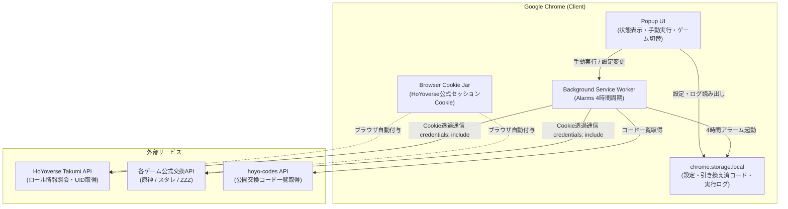

# HoYoPass システムアーキテクチャ & 技術仕様書

本書は、Chrome拡張機能「HoYoPass（交換コード自動引き換えツール）」の内部設計、システム構成、セキュリティモデル、およびアルゴリズム仕様をまとめた技術仕様書です。

---

## 1. システム概要 & 全体構成図

HoYoPassは、Google Chromeの拡張機能仕様（Manifest V3）に準拠したクライアント完結型の拡張機能です。専用のバックエンドサーバーを持たず、ブラウザのバックグラウンドService Workerと公式API、およびオープンソースの交換コードAPIのみと直接通信します。



---

## 2. ゼロトラスト認証 & セキュリティモデル

本拡張機能の最大の設計指針は、**「ユーザーの認証情報を拡張機能自身が触らない・保持しない」** ゼロトラストセキュリティです。

### 2.1 Cookieの非保持とブラウザ委任 (`credentials: 'include'`)
- 通常のスクレイピングや非公式ボットでは、ユーザーにログインCookieの手動貼り付けや入力を求めるケースが多く存在します。これにはCookieの流出や不正利用のリスクが伴います。
- HoYoPassでは、`fetch()` リクエスト時に `credentials: 'include'` を指定することで、ブラウザがすでに保持している公式Cookieをリクエストヘッダーへ自動付加させます。
- 拡張機能のJavaScriptコード内にはCookie情報（`account_mid_v2` や `ltuid` 等）を一切読み込まず、メモリやストレージにも一切保存しません。

### 2.2 最小権限原則（`cookies` 権限の完全排除）
- `manifest.json` において、`cookies` API 権限を明示的に要求していません。
- これにより、悪意あるコードインジェクションや拡張機能の改ざんが発生した場合でも、ユーザーのCookieを盗み出す権限自体が存在しません。

### 2.3 ホスト権限（`host_permissions`）の厳格限定
通信可能なオリジンを以下の公式ドメインおよび検証済みコード配布APIのみに制限しています：
- `https://api-os-takumi.hoyoverse.com/*`（公式ユーザーロール照会API）
- `https://sg-hk4e-api.hoyoverse.com/*`（原神 交換API）
- `https://sg-hkrpg-api.hoyoverse.com/*`（崩壊：スターレイル 交換API）
- `https://public-operation-nap.hoyoverse.com/*`（ゼンレスゾーンゼロ 交換API）
- `https://sg-act-nap-api.hoyoverse.com/*`（ゼンレスゾーンゼロ 交換API）
- `https://hoyo-codes.seria.moe/*`（検証済み公開交換コード取得API: [seriaati/hoyo-codes](https://github.com/seriaati/hoyo-codes)）

### 2.4 Content Security Policy (CSP)
Manifest V3の厳格なCSPを採用し、インラインスクリプトや外部スクリプトのロード（`eval` や外部CDN経由のJSなど）を全面的に遮断しています。

---

## 3. 外部API仕様 & 連携先GitHubリポジトリ

HoYoPassが利用・通信する外部APIの詳細および仕様・ソースコードのリファレンスとなるGitHubリポジトリは以下の通りです。

### 3.1 hoyo-codes API（公開交換コード一覧取得）
- **GitHubリポジトリ**: [seriaati/hoyo-codes (GitHub)](https://github.com/seriaati/hoyo-codes)（ライセンス: GPL-3.0）
- **Web API ホスト**: `https://hoyo-codes.seria.moe`
- **利用エンドポイント**: `GET https://hoyo-codes.seria.moe/codes?game={genshin|hkrpg|nap}`
- **概要**: 原神（`genshin`）、崩壊：スターレイル（`hkrpg`）、ゼンレスゾーンゼロ（`nap`）のアクティブなギフト交換コードを自動収集・検証してJSON形式で配信しているオープンソースREST APIです。
- **実装箇所**: [`src/services/code-fetcher.js`](../../src/services/code-fetcher.js)
- **ライセンス適合性**: 独立したREST APIの呼び出し（HTTP GET）のみであり、GPL-3.0のコピーレフトはクライアント側に伝播しません。詳細な法的分析は [ライセンス適合性調査レポート (docs/legal/license_compliance_report.md)](../legal/license_compliance_report.md) を参照してください。
- **セキュリティ & 防御機構**: `publicFetch`（Cookie送信完全遮断、`no-referrer`）経由で通信を行い、受信ペイロードサイズ上限（256KB）および新規コード取得件数上限（50件）のバリデーションを実施しています。

### 3.2 HoYoverse 内部Web API（ロール照会 & コード引き換え）
HoYoverseの公式Webサイト（HoYoLABおよび各ゲームのギフト交換ページ）が内部通信で使用している公式REST APIです。公式からの公開開発者ポータルや公式GitHubリポジトリは提供されていませんが、オープンソースコミュニティによる解析・仕様リファレンスリポジトリが存在します。

- **ロール照会API（Takumi API）**:
  - エンドポイント: `GET https://api-os-takumi.hoyoverse.com/binding/api/getUserGameRolesByCookie?game_biz={gameBiz}`
  - 概要: ログイン中セッションCookieに紐づくゲーム内キャラクター一覧（UID、サーバー、ニックネーム）を取得。
  - 実装箇所: [`src/services/hoyo-api.js`](../../src/services/hoyo-api.js) (`getUserGameRoles`)
- **コード引き換えAPI（WebExchangeCdkey API）**:
  - 原神: `GET https://sg-hk4e-api.hoyoverse.com/common/apicdkey/api/webExchangeCdkey`
  - 崩壊：スターレイル: `GET https://sg-hkrpg-api.hoyoverse.com/common/apicdkey/api/webExchangeCdkey`
  - ゼンレスゾーンゼロ: `GET https://public-operation-nap.hoyoverse.com/common/apicdkey/api/webExchangeCdkey` / `https://sg-act-nap-api.hoyoverse.com/common/apicdkey/api/webExchangeCdkey`
  - 概要: 指定したUID・リージョン・交換コードでアイテム交換を実行。
  - 実装箇所: [`src/services/hoyo-api.js`](../../src/services/hoyo-api.js) (`redeemCode`)
- **関連オープンソース・コミュニティGitHubリポジトリ（仕様リファレンス）**:
  - [torikushiii/hoyoverse-api (GitHub)](https://github.com/torikushiii/hoyoverse-api) - HoYoverse各タイトルのAPI・コード情報をまとめたオープンソースプロジェクト
  - [thesadru/genshin.py (GitHub)](https://github.com/thesadru/genshin.py) - HoYoverse Web API（Takumi API / 交換API等）の包括的なオープンソースAPIラッパー

---

## 4. 主要コンポーネント構成

```
src/
├── background/
│   └── service-worker.js    # 周期実行アラーム、手動メッセージハンドラ、引き換え一括オーケストレーション
├── config/
│   └── constants.js         # API定数、ゲーム固有エンドポイント設定、URL定義
├── popup/
│   ├── popup.html           # ポップアップUIマークアップ
│   ├── popup.css            # スタイリング（ダークモード基調、レスポンシブ）
│   └── popup.js             # UIイベント処理、ロール取得状態反映、ログ描画
├── services/
│   ├── code-fetcher.js      # hoyo-codes APIからのコード一覧取得・ペイロード検証
│   ├── hoyo-api.js          # Takumi APIロール取得、公式交換API呼び出し
│   └── storage-service.js   # chrome.storageのCRUD操作、排他ロック（Mutex）管理
└── utils/
    └── message-formatter.js # APIレスポンスおよびリターンコードの日本語整形・ダイアログフォーマッタ
```

---

## 5. 排他制御・レート制限・耐障害性アルゴリズム

HoYoverseの公式APIに対する過剰アクセスや連続リクエストによるレート制限・アカウントペナルティを防ぐため、複数の防護機構を実装しています。

### 5.1 排他ロック制御（Mutex）
- 定期実行（`chrome.alarms`）と手動実行（ポップアップの「今すぐ引き換え」）が同時に重なった場合でも二重実行されないよう、`chrome.storage.local` を利用したアトミックロック（有効期限付き）を備えています。
- ロック取得中に別の実行トリガーが発生した場合は即座にスキップされ、二重実行を確実に防ぎます。

### 5.2 順次リクエスト遅延（Inter-Request Delay）
- 1つのコードを引き換えるごとに、次リクエストの送信までに **5.2秒以上** の非同期スリープを挿入します。
- これにより、短時間のバースト通信によるAPIレートリミット（429 Too Many Requests や交換拒否）を回避します。

### 5.3 指数バックオフ & 一時停止（Backoff Duration）
- 引き換えAPIからレートリミットまたは連続エラー（ネットワーク障害等）が返却された場合、自動的に **30分間のバックオフ（クールダウン）状態** に遷移します。
- バックオフ期間中は手動・自動問わず引き換え処理がスキップされ、APIに対する負荷集中を防ぎます。

### 5.4 不正コードのバリデーション & 制限
- **1日あたりの新規コード上限**: 1回の定期実行で引き換える新規コード数を最大20件に制限。
- **ペイロードサイズ制限**: hoyo-codes APIから受信するJSONレスポンスが 256KB を超える場合は安全のために破棄。
- **コード文字種チェック**: 英数字および一般的なハイフン・アンダースコア以外の不正な文字列は弾き、無効なAPIリクエストを未然に防止。

---

## 6. ストレージ設計と容量ローテーションポリシー

ブラウザの `chrome.storage.local`（最大10MB）を使用します。

### 6.1 キー構造
| キー | 型 | 用途 |
| :--- | :--- | :--- |
| `settings` | Object | ユーザー設定（有効化フラグ、選択中ゲームキー、初回同意フラグ等） |
| `redeemed_codes` | Object | ゲーム別引き換え済みコード履歴（重複引き換えの防止） |
| `exec_logs` | Array | 画面表示用の直近実行ログ（タイムスタンプ、メッセージ） |
| `redeem_lock` | Object | 排他ロック用タイムスタンプと実行ID |
| `backoff_until` | Number | バックオフ解除時刻のUNIXエポックミリ秒 |

### 6.2 履歴の整理（ローテーション）
- `redeemed_codes` に蓄積された記録が 3,000 件を超えた場合、古い確定記録から自動的に整理されます。
- `exec_logs` は最新の 50 件のみを保持し、古いログは順次自動破棄されます。

---

## 7. テスト・検証環境

プロジェクトはNode.js組み込みのテストランナー（`node:test` / `node:assert/strict`）を採用しており、外部の重量級フレームワークに依存せず高速にテストを実行可能です。

```bash
# 全単体テストの実行
npm test

# 機密情報（シークレット、秘密鍵）混入スキャン
npm run check-secrets
```

---

## 8. 免責事項 & 権利帰属
本ツールは非公式のオープンソースプロジェクトであり、miHoYo / COGNOSPHEREとは一切提携・承認関係にありません。詳細な著作権、ライセンス情報、および法的適合性検証結果は [NOTICE](../../NOTICE)、[LICENSE](../../LICENSE)、および [ライセンス適合性調査レポート](../legal/license_compliance_report.md) を参照してください。
