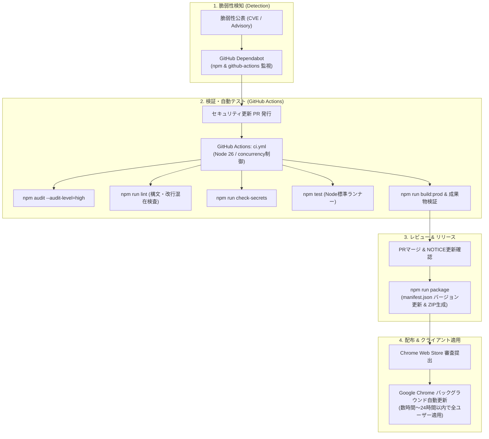
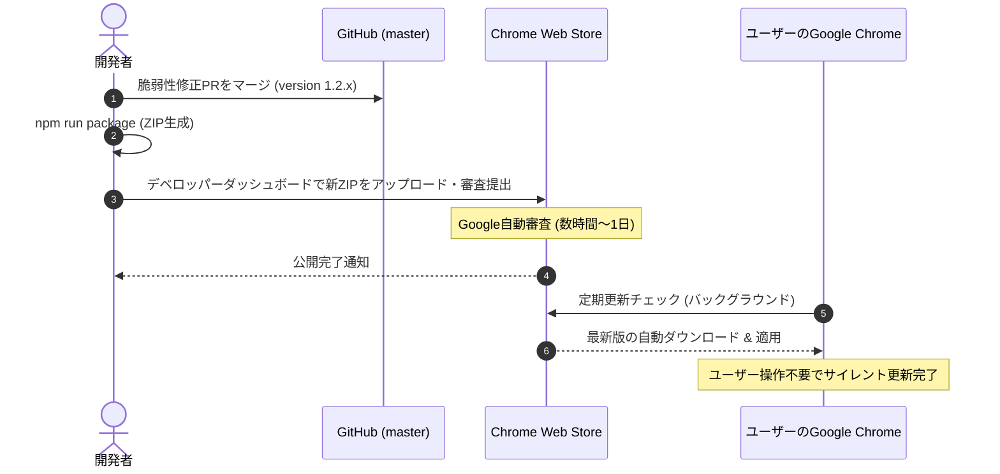

# HoYoPass CI/CD & 脆弱性管理システム設計書

本書は、Chrome拡張機能「HoYoPass」における**完全無料（追加コスト0円）**でのライブラリ脆弱性検知・自動更新・CI/CDパイプライン・ストア配布ライフサイクルに関する技術仕様および運用指針をまとめた設計書です。

---

## 1. 設計方針 & コストモデル

本CI/CDアーキテクチャは、個人開発・オープンソース開発の持続可能性を最大化するため、以下の基本方針に基づいて設計されています。

1. **運用コスト完全0円 (Zero-Cost Operation)**:
   * 有料のSaaSや専用サーバー、外部セキュリティ監視サービスを採用せず、GitHub標準の無料機能（Dependabot / GitHub Actions）およびGoogle Chrome Web Storeの標準配布インフラのみで完結。
2. **「依存ゼロ（Zero-Dependency）」と「ライブラリ導入後」の両対応**:
   * 現状の「外部npmパッケージに依存しない」堅牢性を尊重し、`package-lock.json` が存在しない状態でもCIが正常パスする設計。
   * 将来ライブラリを導入した瞬間に、追加の設定変更なしで自動的に `npm ci` および `npm audit` が有効化されるシームレスな移行性を担保。
3. **ローカル環境との完全合致 (Node.js 26)**:
   * Node.js標準のテストランナー（`node --test`）を活用し、ローカル開発環境（Node.js 26系）とCI環境を一致させ、環境差異によるフォールス・ポジティブを排除。
4. **サプライチェーン攻撃への多層防御**:
   * 最小権限の原則（`permissions: contents: read`）の徹底。
   * プロジェクト既存の `check-secrets.js` によるシークレット漏洩検査の自動化。

---

## 2. 全体アーキテクチャ & ライフサイクル

脆弱性公表からエンドユーザーのブラウザへ修正が届くまでの全自動／半自動フローは以下の通りです。



---

## 3. コンポーネント仕様

### 3.1 脆弱性・依存関係自動監視 (`.github/dependabot.yml`)

外部npmライブラリおよびCI自身が使用する公式GitHub Actionsのセキュリティパッチを週次で監視します。

```yaml
version: 2
updates:
  # 1. npmパッケージの依存関係監視（ライブラリ導入時に自動有効化）
  - package-ecosystem: "npm"
    directory: "/"
    schedule:
      interval: "weekly"
      day: "monday"
    open-pull-requests-limit: 5
    commit-message:
      prefix: "chore(deps)"
    # マイナー/パッチ更新を1つのPRにまとめて通知爆発を防ぐ（無料運用の負荷軽減）
    groups:
      dependencies:
        patterns:
          - "*"
        update-types:
          - "minor"
          - "patch"

  # 2. GitHub Actions自身のセキュリティ・バージョン監視（actions/checkout等）
  - package-ecosystem: "github-actions"
    directory: "/"
    schedule:
      interval: "weekly"
      day: "monday"
    open-pull-requests-limit: 3
    commit-message:
      prefix: "ci(actions)"
```

* **グループ化機能 (`groups`)**:
  * マイナー・パッチ更新を週に1つのPRに統合し、個人開発におけるPRレビュー工数およびActions無料実行枠の消費を抑制。
  * ※重大な脆弱性（Security Updates）が発生した場合は、グループ化設定に関わらず即座に単独PRが自動発行されます。

---

### 3.2 継続的インテグレーション & 監査 (`.github/workflows/ci.yml`)

PR作成時および `master` ブランチへのプッシュ時に起動し、コード品質・セキュリティ・拡張機能ビルドの妥当性を保証します。

```yaml
name: CI & Security Audit

on:
  push:
    branches: [ master ]
  pull_request:
    branches: [ master ]

# 同一ブランチへの連続プッシュ時、古いジョブを即座にキャンセルして無料実行枠（月2,000分）を節約
concurrency:
  group: ${{ github.workflow }}-${{ github.ref }}
  cancel-in-progress: true

# トークン権限を読み取り専用に制限（サプライチェーン攻撃時の被害極小化）
permissions:
  contents: read

jobs:
  test-and-verify:
    name: Test, Audit & Build
    runs-on: ubuntu-latest

    steps:
      - name: Checkout repository
        uses: actions/checkout@v7

      - name: Setup Node.js 26 (Matching local environment)
        uses: actions/setup-node@v7
        with:
          node-version: 26

      # package-lock.json の有無を判定し、依存ゼロ時でもCIが失敗しない動的ステップ
      - name: Install dependencies
        run: |
          if [ -f package-lock.json ]; then
            npm ci
          else
            echo "Zero external dependencies detected. Skipping npm ci."
          fi

      # 重大度High以上の脆弱性を検知した場合にCIをフェイル
      - name: Security audit
        run: |
          if [ -f package-lock.json ]; then
            npm audit --audit-level=high
          else
            echo "No lockfile to audit. Skipping npm audit."
          fi

      # 構文チェックおよび改行混在チェック（依存ゼロ）
      - name: Run lint
        run: npm run lint

      # リポジトリ内のシークレット・APIトークン混入検査
      - name: Check secrets
        run: npm run check-secrets

      # ユニットテスト（Node.js標準テストランナーで実行）
      - name: Run unit tests
        run: npm test

      # 本番用フレーバービルド実行
      - name: Build production bundle
        run: npm run build:prod

      # ビルド成果物の整合性検査（dist/prod/manifest.json の生成確認）
      - name: Verify build artifact
        run: |
          test -f dist/prod/manifest.json || (echo "Build verification failed: manifest.json missing" && exit 1)
```

#### 仕様のハイライト:
1. **動的依存関係処理**:
   * `package-lock.json` がない現状では余計な依存インストールをスキップし、CIの実行時間を**約10〜15秒**に短縮。
   * 今後 `npm install <package>` を実行してlockfileが生成された瞬間から、全自動で厳密な依存再現（`npm ci`）と脆弱性スキャン（`npm audit`）が発動。
2. **コストガード (`concurrency: cancel-in-progress`)**:
   * レビュー中のコミット積み増し時に旧ビルドを自動中断し、GitHub Actions無料枠（プライベート: 月2,000分 / パブリック: 無制限）を徹底節約。

---

## 4. エンドユーザーへの配信 & 適用メカニズム

Chrome拡張機能特有のクライアント配布フローです。自前でCDNやアップデートサーバーをホスティングする必要はありません。



* **緊急時の即時反映**:
  * 拡張機能内から `chrome.runtime.requestUpdateCheck()` を呼ぶことで、通常待機時間を待たずにブラウザへ即時更新確認を要求可能。

---

## 5. 運用ガイドライン & ポリシー

### 5.1 ライブラリ導入時の基本原則（No-Dependency Policy 優先）
* **原則自前実装**:
  * HoYoPassの設計思想である「標準APIのみで完結」「外部依存0」を第一原則とします。
  * 軽微なユーティリティ（文字列操作、日付計算等）のためにライブラリを導入することは原則禁止します。
* **やむを得ず導入する場合の要件**:
  1. `package-lock.json` を必ずリポジトリにコミットし、バージョンを厳格固定する。
  2. ライセンスが商用・再配布に寛容なもの（MIT, BSD, Apache-2.0）であることを確認。
  3. `NOTICE` ファイルへ該当ライブラリの著作権表示およびライセンス情報を追記する。

### 5.2 脆弱性PR（Security Alert）トリアージ手順
1. **影響範囲の特定**:
   * PRの説明文に記載されたCVE情報を確認し、「拡張機能の実行環境（ブラウザ環境）で実際に悪用可能か」を評価。
2. **CI結果の確認**:
   * GitHub Actionsの `test-and-verify` がすべてPassしているか確認。
3. **マージ & リリース**:
   * パッチバージョンをインクリメント（例: `1.2.0` → `1.2.1`）。
   * `npm run package` を実行し、Chrome Web Storeへアップロード。
