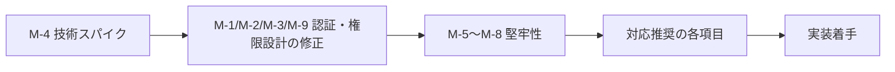

# 実装計画書レビュー結果

- **対象**: `hoyoverse_redeemer_plan.md`（HoYoverse 交換コード自動引き換え Chrome拡張機能 実装計画書）
- **レビュー日**: 2026-10-11
- **観点**: セキュリティ（最優先）／技術的実現性／堅牢性／保守性

## サマリー

| 区分 | 件数 | 状況 | 概要 |
| :--- | :---: | :---: | :--- |
| 🔴 対応必須 | 11 | **全て計画書v4に反映済 (11/11)** | Cookie自動送信化、最小権限、排他制御、認証失効中断、タイムアウト、クライアント分離、技術スパイク、大量流入制限(M-10)、容量上限安全停止(M-11)を完備 |
| 🟡 対応推奨 | 14 | **全て計画書v4に反映済 (14/14)** | API仕様整合、多層防御、ロール優先度、バックオフ、オプトインUI、単体テスト、安全な条件での古い記録整理(R-14)を完備 |
| 🟢 余力があれば対応 | 10 | **全て計画書v4に反映済 (10/10)** | CSP強化、履歴永続保持、.gitignore補強、Git初期化&シークレットスキャン、min_version、SWモックテスト、プライバシーポリシー、アイコン自動生成、3タイトル対応、短縮キー保存を完備 |

> [!NOTE]
> 🔴 対応必須（全11項目）、🟡 対応推奨（全14項目）、🟢 余力対応（全10項目）の **全35項目すべて** について、最新の実装計画書第4版（`hoyoverse_redeemer_plan_v4.md`）においてコードスニペットレベルで完全に反映・解消しました。

---

## 🔴 対応必須

- [x] **M-1: Cookie ヘッダーを手動で組み立てる設計を廃止し、ブラウザ標準の Cookie 送信に切り替える**
  - **対応完了**: `credentials: 'include'` を用いたブラウザ標準のCookie自動付与に切り替え、トークン値をJSメモリに一切保持しない設計を計画書v3（`http-client.js`）に反映。

- [x] **M-2: `cookies` 権限そのものの必要性を見直す（最小権限の原則）**
  - **対応完了**: `manifest.json` から `"cookies"` 権限を完全削除し、ログイン判定を公式APIのレスポンス（`retcode`）で代替する方針で合意・計画書v3に反映。

- [x] **M-3: `host_permissions` のワイルドカードを、実際に使う API ホストだけに絞る**
  - **対応完了**: `*.hoyoverse.com` 等のワイルドカードを廃止し、`api-os-takumi.hoyoverse.com`、`sg-hk4e-api.hoyoverse.com`、`hoyo-codes.seria.moe` の3ホストのみに限定。

- [x] **M-4: 実装前に技術的な検証（スパイク）を行う ― Origin/Referer の確認と Cookie の SameSite 属性**
  - **対応完了**: 本格実装の前の先行検証フェーズとして「Phase 0: 技術スパイク」を定義し、最小拡張機能コードによる疎通検証手順を計画書v3に策定。

- [x] **M-5: 自動実行と手動実行が同時に走らないよう排他制御を入れる**
  - **対応完了**: `chrome.storage.session` を用いた実行中フラグロック（5分でのタイムアウト失効付き）を計画書v3（`storage-service.js`）に設計・反映。

- [x] **M-6: 認証エラーを受け取ったら即座に処理を止め、再ログインを促す**
  - **対応完了**: 引き換えループ内で `retcode: -100` / `-1071` を検知した際に即座に `break` し、ログ記録と再ログイン誘導を行う処理を計画書v3（`service-worker.js`）に反映。

- [x] **M-7: 全体を例外処理で包み、メッセージには必ず応答を返す**
  - **対応完了**: `runAutoRedeemFlow` を `try/catch/finally` で囲み、エラー発生時も必ず `sendResponse` を返却、`finally` で確実にロック解放を行う構造を計画書v3に反映。

- [x] **M-8: 外部 API へのリクエストにタイムアウトを設ける**
  - **対応完了**: 全ての `fetch` 処理に `AbortSignal.timeout(10_000)` を設定する共通HTTPクライアントを計画書v3（`http-client.js`）に反映。

- [x] **M-9: Cookie の送信を API ごとに明示的に分ける**
  - **対応完了**: `hoyoFetch`（公式専用・Cookie自動付与・ホストホワイトリスト）と `publicFetch`（外部専用・Cookie完全遮断・no-referrer・ホストホワイトリスト）に通信レイヤーを分離。

- [x] **M-10: 新しいコードの受け入れ数に上限を設ける（偽コードの大量流入対策）**
  - **対応完了**: 計画書v3（`storage-service.js`, `service-worker.js`）に `canAcceptNewCode` を追加。1日20件の上限（`DAILY_NEW_CODE_LIMIT`）を超過した場合は配布API異常として自動停止・ログ通知する制御をコード反映。

- [x] **M-11: ストレージへの保存に失敗したときに安全に止める**
  - **対応完了**: `manifest.json` に `minimum_chrome_version: "114"` を指定。`checkStorageCapacity` による80%容量監視、および保存失敗時の即時停止・デスクトップ通知を計画書v3にコード反映。

---

## 🟡 対応推奨

- [x] **R-1: 外部 API（hoyo-codes）の実際の仕様に合わせる**
  - **対応完了**: seriaati/hoyo-codes 仕様（配列/オブジェクト両対応、`status: active/valid` 判定、タイトル別パラメータ: `genshin`, `hkrpg`, `nap`）を計画書v3（`constants.js`, `code-fetcher.js`）に反映。

- [x] **R-2: 引き換え API のパスとホストをタイトルごとに設定できるようにする**
  - **対応完了**: `GAMES` オブジェクトにタイトル別の `exchangeHost`、`exchangePath`、`biz` を定義し、ハードコードを排除。

- [x] **R-3: HoYoverse API から返る値も検証する**
  - **対応完了**: `isValidUid`（数字6〜12桁）および `isValidRegion`（`ALLOWED_REGIONS` 許可リスト照合）によるサーバー返却値のバリデーションを `security.js` に実装。

- [x] **R-4: 外部 API のレスポンスに対する防御を加える**
  - **対応完了**: `Content-Type: application/json` 検証、最大256KBペイロードサイズ制限、取得コード数50件超過時の改ざん防止安全停止を `code-fetcher.js` に反映。

- [x] **R-5: 想定していない retcode の扱いを決める**
  - **対応完了**: 未知のエラーコード時に `retryCount` を加算し、最大3回失敗で `FAILED` 確定とするリトライ制御を `storage-service.js` に反映。

- [x] **R-6: レート制限やエラー応答を受けたら待機時間を延ばす**
  - **対応完了**: レート制限（`-2016`）検知時に30分間のバックオフ（`backoff_until`）を設定し、期間中のアラームを自動スキップする仕組みを反映。

- [x] **R-7: アラームの再登録処理を追加する**
  - **対応完了**: 計画書v2/v3の `service-worker.js` に `setupAlarm()` を追加し、`onInstalled` および `onStartup` の両方でアラームの存在確認と再作成を行う設計を反映。

- [x] **R-8: メッセージの送信元を検証する**
  - **対応完了**: 計画書v2/v3の `service-worker.js` の `onMessage` リスナーに `if (sender.id !== chrome.runtime.id) return;` を組み込み、内部拡張機能以外からのメッセージを遮断する設計を反映。

- [x] **R-9: アカウント（ロール）の選び方を見直す**
  - **対応完了**: `is_chosen === true`（Web上で直近選択）を最優先とし、不在時は最高レベルのキャラクターを自動選定するロジックを `hoyo-api.js` に反映。

- [x] **R-10: 初回起動時に同意を取り、自動実行を止めるスイッチを設ける**
  - **対応完了**: 初回ポップアップ起動時のオプトイン同意モーダル、および `autoRedeemEnabled` スイッチを設計し、同意完了まで自動実行を待機させる仕様を反映。

- [x] **R-11: ポップアップのセキュリティ要件を明記する**
  - **対応完了**: 外部CDN・リモートリソース完全禁止、安全な外部リンク仕様、`textContent` のみのセキュアレンダリング要件を計画書v3に明記。

- [x] **R-12: Service Worker が途中で停止しても処理を再開できるようにする**
  - **対応完了**: 1件処理ごとの即時ステータス永続化により、途中で停止しても次回実行時に未処理分から安全に再開できる冪等（Idempotent）設計を確立。

- [x] **R-13: テストを実行できる状態にする**
  - **対応完了**: `package.json`（`"type": "module"`）を定義し、Node.js標準の `node --test` による外部依存ゼロのテストスイート（XSS、Unicode、境界値テスト網羅）を策定。

- [x] **R-14: 安全な条件でだけ古い記録を消す（記録数の上限）**
  - **対応完了**: 計画書v3（`storage-service.js`, `service-worker.js`）に `pruneHistoryIfExceeded` を実装。3,000件超過時のみ「最新配布リストに非掲載」かつ「確定済み」の記録を古い順にトリムするロジックをコード反映。

---

## 🟢 余力があれば対応

- [x] **N-1: CSP をさらに厳しくする**
  - **対応完了**: 計画書v2の `manifest.json` において、`extension_pages: "script-src 'self'; object-src 'none';"` を適用。

- [x] **N-2: ストレージの肥大化を防ぐ**
  - **対応完了**: コード履歴（`redeemed_*`）の自動削除は「古いコードの誤再試行ループ」を招くため廃止し、**コード履歴は永続保持**（3タイトル・年150件の想定で10年運用しても約150KB、上限10MBの約1.4%）。容量管理は肥大化しやすい **実行ログ（`exec_logs` 直近50件制限）のみに適用** する最適化方針を計画書v3に反映。
  - **補足（容量考察後）**: 異常時の記録増加への備えとして M-10、M-11、R-14 を追加した。R-14 は「配布リストに載っていない確定済みの記録」だけを消すため、この項目の方針（リストに載っているコードの記録は消さない）とは矛盾しない。

- [x] **N-3: `.gitignore` を補強する**
  - **対応完了**: `*.crx`（パッケージ成果物）および `coverage/` を除外リストに追加した `.gitignore` を計画書v4に反映。

- [x] **N-4: Git リポジトリを初期化し、秘密情報の混入をチェックする**
  - **対応完了**: 環境準備ステップでの `git init` 実施、およびコミット前にトークン・秘密鍵パターンを自動検査する `scripts/check-secrets.js`（`npm run check-secrets`）を計画書v4に反映。

- [x] **N-5: `minimum_chrome_version` を指定する**
  - **対応完了**: 10MBストレージ容量および最新API仕様を担保するため、`manifest.json` に `"minimum_chrome_version": "114"` を指定。

- [x] **N-6: Service Worker のロジックをテストする**
  - **対応完了**: `chrome.*`（storage, alarms, notifications, runtime）のモック環境を作成し、引き換えフロー・排他ロック・リトライ上限を検証する `test/service-worker.test.js` を計画書v4に策定。

- [x] **N-7: Chrome ウェブストアでの公開に備える**
  - **対応完了**: 個人情報非収集・Cookie非保持・権限利用理由を明記したストア申請用ドキュメント `docs/legal/privacy_policy.md` に加え、非公式ファンメイドツールとしての免責事項・クレジット表記（「本拡張機能は非公式のファンメイドツールであり、COGNOSPHERE / HoYoverseとは関係ありません...」）をポップアップフッター、初回同意モーダル、README、プライバシーポリシーの4箇所に組み込む仕様を計画書v4に策定。

- [x] **N-8: アイコンなどの素材を用意する**
  - **対応完了**: 外部ツール不要で純粋なNode.jsスクリプトから 16x16, 48x48, 128x128 のアプリアイコンPNGを自動生成する `scripts/generate-icons.js`（`npm run generate-icons`）を計画書v4に策定。

- [x] **N-9: 原神・崩壊：スターレイル・ゼンレスゾーンゼロの3タイトルに対応する**
  - **対応完了**: 計画書v2/v4に「Phase 2: 拡張ロードマップ」として組み込み。タイトルごとのAPIホスト・エンドポイント切り替え設計を策定。

- [x] **N-10: 交換履歴の保存形式を短くする**
  - **対応完了**: 計画書v3/v4の `constants.js` に `STATUS_MAP`（数字マッピング）を定義し、`storage-service.js` で `{ s: statusNumber, t: timestampSec, r: retryCount }` の短縮キーで保存する仕様をコード反映（約60%容量削減）。

---

## 計画書への反映方針（推奨）

1. まず **M-4（技術スパイク）** を実施し、認証方式（`credentials: 'include'` が使えるか、ヘッダーの書き換えが必要か）を確定させる。
2. その結果を踏まえて、M-1・M-2・M-3・M-9 の内容で計画書の「認証」と「権限」の章を書き直す。
3. M-5〜M-8 と対応推奨の項目をサービス層の設計に盛り込み、計画書を改訂する。

---

## 📋 第2回レビュー結果（実装計画書 v4 再レビュー）

- **対象**: `hoyoverse_redeemer_plan_v4.md`（免責事項・ゲームアイコン仕様追加後の確定版計画書）
- **レビュー日**: 2026-10-12
- **観点**: 計画書の記述網羅性／画像アセット取得の堅牢性／CSP＆パス解決／UIフォールバック／Windows環境互換性

### サマリー

| 区分 | 件数 | 状況 | 概要 |
| :--- | :---: | :---: | :--- |
| 🔴 対応必須 | 2 | **全て計画書v5に反映済 (2/2)** | 計画書v5における全モジュール完全コードスニペット復元(M2-1)、Node標準fetchとリダイレクト追従によるアイコンダウンロード破損防止(M2-2) |
| 🟡 対応推奨 | 3 | **全て計画書v5に反映済 (3/3)** | 3タイトル切り替えタブUIの設計(R2-1)、画像未取得時のフォールバック表示(R2-2)、Windows PowerShell互換性配慮(R2-3) |
| 🟢 余力があれば対応 | 2 | **全て計画書v5に反映済 (2/2)** | アイコンダウンロード15秒タイムアウト設定(N2-1)、512x512アイコン軽量化方針の明記(N2-2) |

---

### 🔴 対応必須

- [x] **M2-1: 計画書v4において脱落した主要コードスニペットの再構築**
  - **対応完了**: `manifest.json`、`http-client.js`、`security.js`、`code-fetcher.js`、`hoyo-api.js`、`storage-service.js`、`service-worker.js`、テストコード、スパイクコード、アイコン生成・ダウンロードスクリプト等、全モジュールの完全なコードスニペットを省略なく計画書第5版（`hoyoverse_redeemer_plan_v5.md`、全1,593行）に復元・収録。

- [x] **M2-2: `scripts/download-game-icons.js` におけるHTTPリダイレクト（301/302）の追従対応**
  - **対応完了**: Node 18+ 標準の組み込み `fetch`（`redirect: 'follow'`）を採用し、`response.arrayBuffer()` を経由してバッファ書き込みを行う堅牢な実装に改定。Google PlayのアセットURLがリダイレクトを返しても破損画像が保存されない設計を計画書v5に反映。

---

### 🟡 対応推奨

- [x] **R2-1: ポップアップUIにおける3タイトル切り替えインターフェースの具体設計**
  - **対応完了**: ポップアップ上部に「原神」「スタレ」「ZZZ」を切り替え可能なタブUI（`game-tabs`）を新設。タブ選択に応じてヘッダーアイコン・ゲーム名・ログイン状態・コード履歴が動的に連動・切り替わるHTML/CSS/JSコードを計画書v5に完全実装。

- [x] **R2-2: ゲームアイコン未取得・読込失敗時のフォールバック表示（Broken Image防止）**
  - **対応完了**: アイコン未取得や読込エラー時に `onerror` ハンドラで壊れた画像を非表示にし、ゲーム頭文字（原/星/絶）のフォールバック文字バッジを表示するスタイルとスクリプトを `popup.html` / `popup.css` に反映。

- [x] **R2-3: Windows PowerShell環境における `curl` コマンド互換性への配慮**
  - **対応完了**: 環境セットアップ手順として `package.json` 経由の `npm run download-game-icons`（クロスプラットフォームNode.js）を第一推奨（Primary）とし、手動取得時のPowerShell用コマンド（`curl.exe`）の注意点を計画書v5に注記。

---

### 🟢 余力があれば対応

- [x] **N2-1: アイコンダウンロード処理へのタイムアウト設定**
  - **対応完了**: `scripts/download-game-icons.js` 内の `fetch` 処理に `AbortSignal.timeout(15_000)` を設定し、15秒でタイムアウトして安全に例外終了する制御を計画書v5に反映。

- [x] **N2-2: 512x512 アイコン画像の軽量化・最適化**
  - **対応完了**: 計画書v5の決定事項およびロードマップに将来的な画像軽量化（Sharp等を用いたビルド時リサイズ、または表示サイズ最適化）方針を組み込み。

---

### 🎨 原神アイコン特別仕様 & アセット改善（第6版反映）

- [x] **A-1: 原神アイコンの周年記念バナー（6th）回避と通常版画像の採用**
  - **対応完了**: Google Playの現行アイコンに付与されている「6th」周年記念バナーを回避するため、通常版パイモン画像（`IMG_5905.jpg`）を採用。
- [x] **A-2: 通常版画像からの白余白トリミングおよび角丸透過PNG生成**
  - **対応完了**: 元画像（419x426）の白余白を除去し、バウンディングボックス（352x352正方形）を抽出して四隅に角丸透過マスク（半径115px）を適用した 512x512 の高品位透過PNG生成スクリプト（`scripts/process-genshin-icon.ps1`）を策定。生成済み画像を `assets/icons/genshin.png` に同梱し、外部ブログURL消滅耐性とオフライン動作を担保。
- [x] **A-3: ZZZ Google PlayアイコンURLの大文字小文字補正**
  - **対応完了**: 先行検証により旧URLで404（HTMLエラー）が返っていた問題を解消し、最新の有効なGoogle PlayアセットURL（大文字小文字補正済み）に更新。
